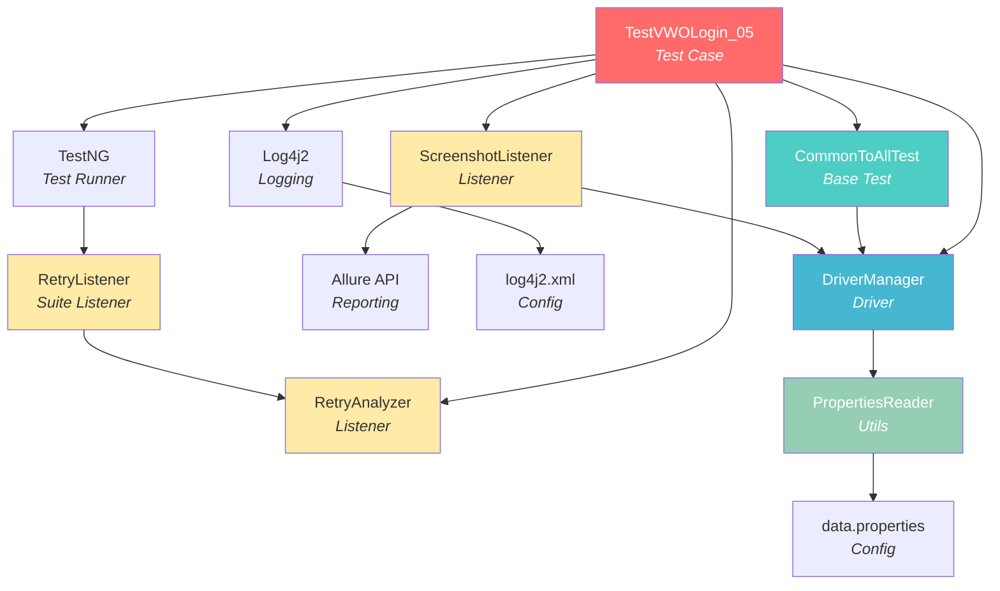

# 🔄 Migration Plan: Selenium → Playwright (Test Case #1)

## Test Case Under Migration

**Selenium Source:**
`TestVWOLogin_05_TakeScreen_Retry_Prop_Improved_POM.java`

**Target Repository:** `PlaywrightMigratedFramework/`

**Base Framework:**  `Advance-Playwright-Framework/` (architecture & patterns to follow)

---

## 1. Test Case Analysis

### 1.1 What the Selenium Test Does

The test class `TestVWOLogin_05_TakeScreen_Retry_Prop_Improved_POM` contains **two test methods**:

| Method | Description | Expected Result |
|---|---|---|
| `testFail()` | Opens `https://app.vwo.com`, logs a message, then asserts `false` | **Always fails** — designed to trigger retry + screenshot |
| `testPass()` | Opens `https://app.vwo.com`, logs a message, then asserts `true` | **Always passes** |

### 1.2 Cross-Cutting Concerns Exercised

| Concern | Selenium Mechanism | Details |
|---|---|---|
| **Browser Lifecycle** | `CommonToAllTest` `@BeforeMethod` / `@AfterMethod` → `DriverManager.init()` / `DriverManager.down()` | Chrome launched via properties file config |
| **Retry on Failure** | `@Test(retryAnalyzer = RetryAnalyzer.class)` + `RetryListener` (TestNG suite-level) | Max **3 retries** before final failure |
| **Screenshot on Failure** | `@Listeners(ScreenshotListener.class)` | Captures PNG, saves to `failure_screenshots/`, attaches to Allure report |
| **Configuration** | `PropertiesReader` → `data.properties` | Reads `browser`, `url`, credentials, error messages |
| **Logging** | Log4j2 (`LogManager.getLogger`) | Console + file (`logs/test.log`) |
| **Reporting** | Allure (`@Owner`, `@Description`, `Allure.addAttachment`) | Metadata annotations + screenshot attachments |

---

## 2. Complete Dependency Graph

Below is every Java file the test case directly or transitively depends on:



---

## 3. Java Files That Need a TypeScript Equivalent

### 3.1 Files To Migrate (8 Java files + 2 config files)

| # | Selenium Java File | Purpose | TypeScript Target (in `PlaywrightMigratedFramework/`) | Priority |
|---|---|---|---|---|
| 1 | `src/main/resources/data.properties` | App config (URLs, creds, browser) | `src/config/index.ts` + `.env` | 🔴 P0 |
| 2 | `src/main/resources/log4j2.xml` | Logging config | `src/utils/Logger.ts` (reuse from base framework) | 🟡 P1 |
| 3 | `src/main/java/.../utils/PropertiesReader.java` | Reads key-value config | `src/config/index.ts` (dotenv-based, from base framework) | 🔴 P0 |
| 4 | `src/main/java/.../driver/DriverManager.java` | Browser init/teardown | **Not needed** — Playwright handles this natively | ⚪ N/A |
| 5 | `src/main/java/.../driver/DriverManagerTL.java` | ThreadLocal (empty) | **Not needed** — Playwright has built-in parallelism | ⚪ N/A |
| 6 | `src/main/java/.../base/CommonToAllPage.java` | Base page (click, type, getText) | `src/pages/VWOLoginPage.ts` (inline Playwright actions) | 🟡 P1 |
| 7 | `src/test/java/.../base/CommonToAllTest.java` | BeforeMethod/AfterMethod setup | **Not needed** — Playwright fixtures handle this | ⚪ N/A |
| 8 | `src/test/java/.../listeners/RetryAnalyzer.java` | Retry failed tests (max 3) | `playwright.config.ts` → `retries: 3` | 🔴 P0 |
| 9 | `src/test/java/.../listeners/RetryListener.java` | Applies retry to all tests | `playwright.config.ts` → `retries: 3` | 🔴 P0 |
| 10 | `src/test/java/.../listeners/ScreenshotListener.java` | Screenshot on failure | `playwright.config.ts` → `screenshot: 'only-on-failure'` | 🔴 P0 |
| 11 | `src/main/java/.../utils/TakeScreenShot.java` | Manual screenshot utility | **Built-in** — `page.screenshot()` + config | ⚪ N/A |
| 12 | `src/main/java/.../utils/WaitHelpers.java` | Explicit/Fluent waits | `src/utils/WaitHelper.ts` (reuse from base framework) | 🟡 P1 |
| 13 | `testng_vwo_..._part5.xml` | TestNG suite definition | `playwright.config.ts` project config | 🔴 P0 |
| 14 | **Test Case itself** | `TestVWOLogin_05_TakeScreen_Retry_Prop_Improved_POM.java` | `src/tests/vwo-login.spec.ts` | 🔴 P0 |

### 3.2 Summary Count

| Category | Migrate | Reuse from Base | Not Needed (Playwright-native) |
|---|---|---|---|
| Config | 2 files | — | — |
| Utils | — | 2 files (Logger, WaitHelper) | 2 files (TakeScreenShot, WaitHelpers partially) |
| Driver / Base | — | — | 3 files (DriverManager, DriverManagerTL, CommonToAllTest) |
| Listeners | — | — | 3 files (config replaces all) |
| Pages | 1 file (new) | — | — |
| Tests | 1 file (new) | — | — |
| **Total** | **3 new files** | **2 reused** | **8 eliminated** |

---

## 4. Migration Order

> [!IMPORTANT]
> Follow this exact order. Each layer depends on the one above it.

```
Step 1 ─── Config & Environment ───────────────── Foundation
Step 2 ─── Utils (Logger, WaitHelper) ─────────── Reuse from base
Step 3 ─── Pages (VWOLoginPage) ───────────────── New Page Object
Step 4 ─── Modules (VWOLoginModule) ───────────── Business logic layer
Step 5 ─── Fixtures ───────────────────────────── DI via Playwright fixtures
Step 6 ─── Tests (vwo-login.spec.ts) ──────────── Final test file
```

### Step-by-Step Breakdown

#### Step 1: Config & Environment (`src/config/` + `.env` + `playwright.config.ts`)

| Task | Details |
|---|---|
| Create `.env` | Add `BASE_URL=https://app.vwo.com`, VWO credentials from `data.properties` |
| Create `src/config/index.ts` | Follow base framework pattern: `dotenv.config()`, export typed `AppConfig` object |
| Create `playwright.config.ts` | Copy from base framework, then customize: `testDir`, `retries: 3`, `screenshot: 'only-on-failure'`, `video: 'retain-on-failure'`, `trace: 'retain-on-failure'` |

**Concept Mapping:**
```
data.properties (Java)  →  .env + src/config/index.ts (TypeScript)
PropertiesReader.java   →  dotenv + config object (no custom reader needed)
RetryAnalyzer (max 3)   →  playwright.config.ts { retries: 3 }
ScreenshotListener      →  playwright.config.ts { screenshot: 'only-on-failure' }
TestNG suite XML         →  playwright.config.ts { projects: [...] }
```

#### Step 2: Utils — Reuse from Base Framework

| File | Action |
|---|---|
| `src/utils/Logger.ts` | **Copy as-is** from `Advance-Playwright-Framework`. Replaces Log4j2 + log4j2.xml |
| `src/utils/WaitHelper.ts` | **Copy as-is** from `Advance-Playwright-Framework`. Replaces WaitHelpers.java |
| `src/utils/index.ts` | **Copy as-is** from `Advance-Playwright-Framework` |

#### Step 3: Pages — New VWO Login Page Object (`src/pages/VWOLoginPage.ts`)

This is a **new file** that follows the base framework's Page Object pattern (seen in `LoginPage.ts`).

**What to model from Selenium:**
- The test directly calls `getDriver().get("https://app.vwo.com")` — no dedicated page object exists in the Selenium code for this test
- But `CommonToAllPage.java` provides reusable actions (`clickElement`, `enterInput`, `getText`)
- The VWO improved POM pages (`LoginPage.java`, `DashBoardPage.java` under `improved_POM/`) are available for richer page object if needed later

**Page Object Structure** (following base framework's `LoginPage.ts` pattern):
- Locators as arrow functions
- Actions as async methods
- Assertions as `expect*` methods

#### Step 4: Modules — New VWO Login Module (`src/modules/VWOLoginModule.ts`)

Following the base framework's `LoginModule.ts` pattern:
- Compose page objects
- Provide high-level business flows: `navigateToVWO()`, `verifyPageLoaded()`
- Structured logging via `Logger.create('VWOLoginModule')`

#### Step 5: Fixtures (`src/fixtures/index.ts`)

Extend the base framework's fixture pattern:
- Register `vwoLoginPage: VWOLoginPage` fixture
- Register `vwoLoginModule: VWOLoginModule` fixture
- These replace `CommonToAllTest.java` `@BeforeMethod/@AfterMethod` entirely

#### Step 6: Tests (`src/tests/vwo-login.spec.ts`)

The final test file migrating the two Selenium test methods:

| Selenium Method | Playwright Equivalent |
|---|---|
| `testFail()` — navigate + `Assert.assertTrue(false)` | `test('should fail intentionally', ...)` with `expect(false).toBeTruthy()` |
| `testPass()` — navigate + `Assert.assertTrue(true)` | `test('should pass successfully', ...)` with `expect(true).toBeTruthy()` |

---

## 5. Concept Mapping — Selenium/TestNG → Playwright

| Selenium / TestNG Concept | Playwright Equivalent | Notes |
|---|---|---|
| `WebDriver` / `DriverManager` | `page` (injected by Playwright) | No manual browser management needed |
| `@BeforeMethod` / `@AfterMethod` | `test.beforeEach()` / `test.afterEach()` or Fixtures | Fixtures are preferred in the base framework |
| `@Test` | `test('name', async ({page}) => {...})` | — |
| `@Listeners(ScreenshotListener)` | `playwright.config.ts` → `screenshot: 'only-on-failure'` | Automatic, no listener code |
| `@Test(retryAnalyzer)` | `playwright.config.ts` → `retries: 3` | Global config, no per-test boilerplate |
| `RetryListener` (suite-level) | `playwright.config.ts` → `retries` | Single config line |
| `Assert.assertTrue()` | `expect(...).toBeTruthy()` | Playwright's `expect` API |
| `getDriver().get(url)` | `page.goto(url)` | — |
| `Log4j2 Logger` | `Logger.ts` (custom, from base framework) | Console-based, no XML config |
| `Allure @Owner / @Description` | `test.describe` / `test.info().annotations` or tags | `@P0`, `@Smoke` tags via test title |
| `Allure.addAttachment` | `testInfo.attach()` | Playwright built-in |
| `data.properties` | `.env` + `src/config/index.ts` | `dotenv` package |
| `TestNG suite XML` | `playwright.config.ts` `projects` | — |
| `Thread.sleep()` | `page.waitForTimeout()` (discouraged) | Prefer Playwright auto-waiting |
| `WebDriverWait` / `FluentWait` | Playwright auto-waiting + `WaitHelper.ts` | — |
| `TakesScreenshot` | `page.screenshot()` / config setting | Built-in |
| `FileUtils.copyFile` | **Not needed** | Playwright saves artifacts automatically |
| `pom.xml` (Maven deps) | `package.json` (npm deps) | — |
| `testng_*.xml` (suite runner) | CLI: `npx playwright test` with `--project` | — |
| `Apache POI / Excel` | JSON files (`src/testdata/vwo-users.json`) | Native JS parsing, strongly typed |
| `By.id` / `By.xpath` | Playwright built-in semantic locators | e.g. `getByRole`, `getByPlaceholder` |
| `Allure Report` | Native + `CustomTTAReporter.ts` | Enhanced live HTML report |

---

## 6. Files to Create in `PlaywrightMigratedFramework/`

Below is the exact file tree that will be created:

```
PlaywrightMigratedFramework/
├── .env                              ← VWO credentials + URLs
├── .gitignore                        ← Copy from base framework
├── package.json                      ← Copy from base framework
├── playwright.config.ts              ← Customized (retries:3, VWO baseURL)
├── tsconfig.json                     ← Copy from base framework
└── src/
    ├── config/
    │   └── index.ts                  ← VWO-specific config (migrates data.properties + PropertiesReader)
    ├── fixtures/
    │   └── index.ts                  ← VWOLoginPage + VWOLoginModule fixtures
    ├── modules/
    │   └── VWOLoginModule.ts         ← Business flow layer
    ├── pages/
    │   └── VWOLoginPage.ts           ← Page Object for app.vwo.com
    ├── testdata/
    │   ├── types.ts                  ← VWO-specific type definitions
    │   └── vwo-users.json            ← Valid/invalid VWO credentials
    ├── tests/
    │   └── vwo-login.spec.ts         ← Migrated test case
    └── utils/
        ├── Logger.ts                 ← Reuse from base framework
        ├── WaitHelper.ts             ← Reuse from base framework
        └── index.ts                  ← Reuse from base framework
```

**Total new/modified files: 14**

---

## 7. What Gets Eliminated (Selenium Boilerplate → Playwright Built-ins)

> [!TIP]
> The Advanced Playwright Framework eliminates **8 out of 13 Selenium source files** because Playwright handles these concerns natively.

| Eliminated Selenium File | Why Not Needed |
|---|---|
| `DriverManager.java` (65 lines) | Playwright creates/destroys browser per test automatically |
| `DriverManagerTL.java` (8 lines) | Playwright has built-in parallel isolation per worker |
| `CommonToAllTest.java` (21 lines) | Playwright fixtures replace `@BeforeMethod/@AfterMethod` |
| `RetryAnalyzer.java` (18 lines) | `playwright.config.ts` → `retries: 3` (one line) |
| `RetryListener.java` (16 lines) | Not needed — Playwright config handles retries globally |
| `ScreenshotListener.java` (53 lines) | `playwright.config.ts` → `screenshot: 'only-on-failure'` (one line) |
| `TakeScreenShot.java` (43 lines) | `page.screenshot()` built-in + auto-capture on failure |
| `log4j2.xml` (20 lines) | `Logger.ts` utility from base framework (no XML config) |
| **Total eliminated** | **~244 lines of Java boilerplate** |

---

## 8. Risk Analysis & Mitigation

| Risk | Impact | Mitigation |
|---|---|---|
| VWO app selectors may differ from base framework's generic selectors | 🟡 Medium | Inspect `app.vwo.com` live to capture actual selectors before writing page objects |
| VWO may have CAPTCHA or rate-limiting | 🔴 High | Check if VWO blocks automated browsers; may need to use API-based login or test account bypass |
| `testFail()` intentionally fails — retry behavior must be validated | 🟡 Medium | Verify that Playwright retries it exactly 3 times (matching Selenium's `maxRetryCount = 3`) |
| Allure reporting annotations (`@Owner`, `@Description`) have no direct 1:1 in Playwright | 🟢 Low | Use `test.info().annotations.push(...)` or structured `test.describe` grouping |
| Base framework targets `localhost:3000` — migrated tests target `app.vwo.com` | 🟡 Medium | Override `baseURL` in `.env` and `playwright.config.ts` for VWO project |

---

## 9. Acceptance Criteria

The migration of this test case is **complete** when:

- [ ] **AC-1**: `npx playwright test src/tests/vwo-login.spec.ts` runs successfully
- [ ] **AC-2**: `testPass` equivalent passes on first attempt
- [ ] **AC-3**: `testFail` equivalent fails, is **retried 3 times**, then marked as failed
- [ ] **AC-4**: A screenshot is automatically captured for the failed test in `test-results/`
- [ ] **AC-5**: Logger output appears in console during test execution
- [ ] **AC-6**: VWO URL and credentials are read from `.env` (not hardcoded)
- [ ] **AC-7**: The framework follows the **exact layered architecture** of the Advance-Playwright-Framework:
  - `config/` → `utils/` → `pages/` → `modules/` → `fixtures/` → `tests/`
- [ ] **AC-8**: No Selenium/TestNG imports exist anywhere in the migrated code
- [ ] **AC-9**: Native HTML report and **Custom TTA HTML Report** are generated successfully.
- [ ] **AC-10**: Locators migrate from legacy CSS/XPath to modern semantic locators (`getByRole`, `getByPlaceholder`, `getByText`).
- [ ] **AC-11**: Test data is successfully migrated from Apache POI (Excel) format to a native JSON structure.

---

## 10. Execution Plan (Estimated)

| Phase | Task | Est. Time |
|---|---|---|
| Phase 1 | Scaffold project (`package.json`, `tsconfig.json`, `.gitignore`, `.env`) | 15 min |
| Phase 2 | Create `playwright.config.ts` with VWO-specific settings | 10 min |
| Phase 3 | Create `src/config/index.ts` (migrate `data.properties`) | 10 min |
| Phase 4 | Copy utils from base framework (`Logger`, `WaitHelper`) | 5 min |
| Phase 5 | Create `VWOLoginPage.ts` page object | 20 min |
| Phase 6 | Create `VWOLoginModule.ts` module | 15 min |
| Phase 7 | Create fixtures (`src/fixtures/index.ts`) | 10 min |
| Phase 8 | Create `vwo-login.spec.ts` test file | 15 min |
| Phase 9 | Run tests, debug, validate acceptance criteria | 20 min |
| **Total** | | **~2 hours** |

---

> [!CAUTION]
> **DO NOT start coding until this plan is reviewed and approved.** This document is the blueprint — migration begins only after sign-off.

---

## 11. CI/CD, Reporting, and Advanced Features

Based on the strategic review, the following core decisions are incorporated into the migration:

- **Parallelism & Sharding:** Handled natively by Playwright workers locally, and by the `Jenkinsfile` and `docker-compose.yml` via `--shard=$SHARD/$SHARD_COUNT` for scalable remote runs.
- **Reporting:** Dropped Allure. Will use Playwright's native reporters and the `CustomTTAReporter.ts` from the Base Framework to generate rich, live HTML dashboards.
- **Data-Driven Testing:** Dropped Apache POI and Excel dependencies. Test data is fully managed using fast, easily typed JSON files.
- **Resilient Locators:** Modernizing legacy `By.id` and `By.xpath` directly into Playwright's recommended user-facing semantic locators (`getByRole`, etc) for improved stability.
- **CI/CD Integration:** The target framework dynamically inherits a complete Dockerized Jenkins pipeline to support automated cross-browser runs and reporting out of the box.
